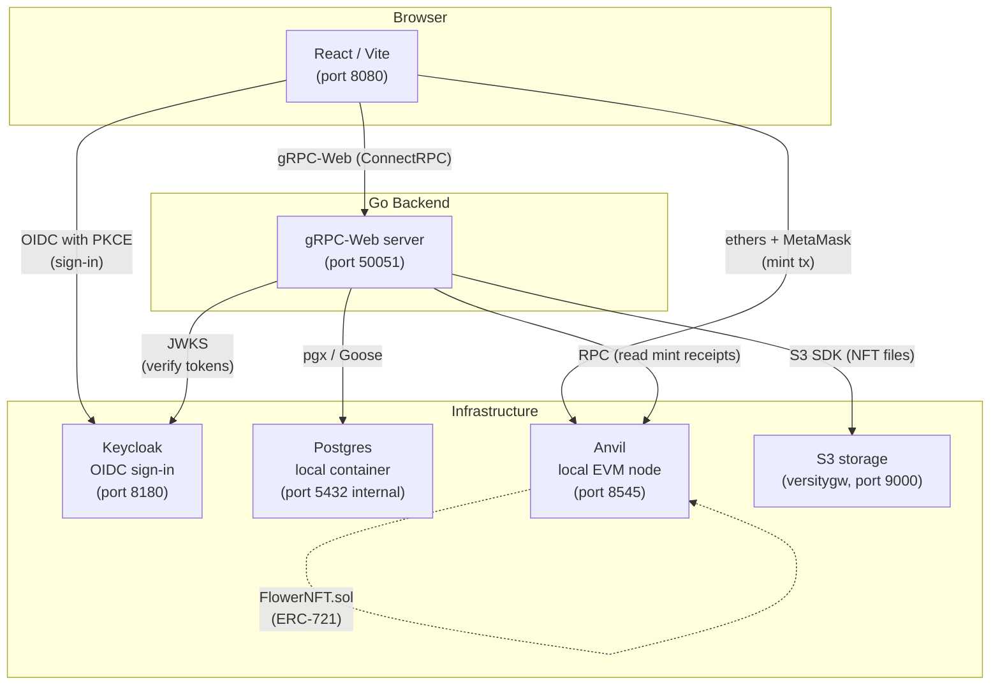

# Petal Pixel

> Generate algorithmically unique flower NFTs, save them to the cloud, and mint them on-chain — all from a single React app backed by a Go gRPC service.

## Live Demo

> Coming soon — link will be added here once deployed.

## Screenshots

> _Screenshots will be placed in `docs/assets/` once the deployment environment is set up._
>
> | Create & Customise | My Flowers Gallery | Mint on-chain |
> |---|---|---|
> | _(screenshot)_ | _(screenshot)_ | _(screenshot)_ |

---

## What is Petal Pixel?

Petal Pixel is a full-stack Web3 application where users:

1. **Generate** a unique procedural flower by entering a name or phrase (used as a seed) and tweaking visual parameters via real-time sliders. The v2 generator (`algo_version: "v2"`) emits a full render-ready parameter set with hybrid palettes and nine flower families — including the new `sunflower`, `rhodonea`, and `superformula` 3D forms — while already-saved v1 flowers keep rendering unchanged.
2. **Save** the flower to their account; all data is persisted in Postgres so it appears on every device they log in from.
3. **Mint** it as an ERC-721 NFT on a local Ethereum network (Anvil), receiving a transaction hash and token URI.

The project was built to exercise the full integration path: browser UI ↔ gRPC service ↔ cloud database ↔ smart contract.

---

## Architecture



### Data flow: Save a flower
1. User adjusts sliders → React calls `CreateFlower` via gRPC-Web.
2. Go server generates deterministic params, writes a row to `flowers` (local Postgres container).
3. On save, `UpsertGardenFlower` writes a `saved_flowers` row for the signed-in user (includes the full `params` JSON for cross-device sync).

### Data flow: Mint
1. Frontend calls `PrepareMint` with the flower's ID and the wallet address. The call needs a signed-in user.
2. Go server refuses a flower that is already minted, stores the image and metadata under content-hash keys that never change, and returns a signed EIP-712 voucher.
3. Browser (ethers + MetaMask) sends `mint(voucher, signature)` to Anvil. The contract checks the signature and allows one mint per flower.
4. Frontend calls `ConfirmMint` with the transaction hash. Go server reads the receipt from the chain and stores the owner from the contract's `Minted` event.
4. Frontend calls `ConfirmMint` with the resulting tx hash; the backend records it to `mints` and the data is persisted to `user_flowers`.

---

## Tech Stack

### Frontend — `petal-pixel-studio/`

| Area | Technology |
|---|---|
| Framework | React 18 + Vite 7 |
| Language | TypeScript 5 |
| Routing | React Router 6 (data router — required for `useBlocker`) |
| State | Zustand 5 with `persist` middleware (localStorage cache) |
| Server state | TanStack Query 5 |
| UI components | shadcn/ui (Radix UI primitives + Tailwind CSS 3) |
| 3D rendering | Three.js + React Three Fiber + Drei |
| Animations | Framer Motion |
| Theming | next-themes (dark / light) |
| Forms | react-hook-form + Zod |
| Backend transport | ConnectRPC (`@connectrpc/connect-web`) over gRPC-Web |
| Auth | OIDC with PKCE (`oidc-client-ts`) |
| Testing | Vitest + Testing Library + Playwright |

### Backend — `flower-backend/`

| Area | Technology |
|---|---|
| Language | Go 1.25 |
| API protocol | gRPC (google.golang.org/grpc) + gRPC-Web (improbable-eng) |
| Schema | Protocol Buffers v3, generated via Buf CLI |
| Database driver | pgx v5 |
| Sign-in | OIDC token verification (`go-oidc`), Keycloak locally |
| Chain access | go-ethereum: EIP-712 vouchers, mint receipts |
| Migrations | Goose v3 (auto-runs on startup) |
| Asset storage | AWS S3 SDK v2 (optional, for NFT image upload) |
| Blockchain client | None — the browser (MetaMask + ethers) sends chain transactions directly |
| Config | `godotenv` (`.env` file) |

### Web3 / Smart Contracts — `flower-backend/contracts/`

| Area | Technology |
|---|---|
| Contract language | Solidity ^0.8.20 |
| Standard | ERC-721 with URI storage (`OpenZeppelin v5.6.1`) |
| Dev environment | Foundry (Forge + Anvil) |
| Local chain | Anvil at `chain-id 1337` (set explicitly via `--chain-id 1337`; Anvil's own default would be 31337) |
| Wallet | MetaMask (browser extension) |

### Dev Tooling — root

| Tool | Purpose |
|---|---|
| Docker Compose (`docker-compose.yml`) | One-command startup (`docker compose up -d --build`) and shutdown (`docker compose down`) |
| `tools/docker/deploy.sh` | Forge script → broadcast → extract contract address → pass to backend |
| `tools/docker/buf.sh` | Regenerate proto stubs (Go + frontend TS) via pinned `bufbuild/buf:1.47.2` — no host Buf/Go needed |
| `docker compose run --rm codegen` | Same codegen as `buf.sh`, as an optional Compose service (under the `tools` profile, so it stays out of `docker compose up`) |

---

## Repository Layout

```
petal-pixel/
├── docker-compose.yml            # one-command dev runner (all services)
├── tools/docker/
│   └── deploy.sh                 # forge deploy + contract address extraction
│
├── flower-backend/               # Go gRPC server + Solidity contracts
│   ├── cmd/server/main.go        # entry point
│   ├── contracts/FlowerNFT.sol   # ERC-721 NFT contract
│   ├── script/Deploy.s.sol       # Foundry deployment script
│   ├── internal/
│   │   ├── api/grpc/             # gRPC service handlers + DB store
│   │   ├── flower/               # procedural flower generator
│   │   └── nft/                  # NFT metadata builder
│   ├── proto/flower/v1/          # Protobuf service definition
│   ├── gen/                      # Buf-generated Go code
│   ├── db/migrations/            # Goose SQL migrations
│   └── foundry.lock              # Foundry dependency lock (OZ v5.6.1)
│
└── petal-pixel-studio/           # React / Vite frontend
    ├── src/
    │   ├── pages/                # CreateFlower, MyFlowers, NftCollection …
    │   ├── stores/flowerStore.ts # Zustand store (backend as source of truth)
    │   ├── integrations/         # OIDC sign-in, gRPC client, garden API
    │   ├── math/                 # Procedural flower geometry (pure TS)
    │   └── components/           # UI components (shadcn + custom)
    └── tests/                    # Playwright end-to-end tests
```

---

## Quickstart (Docker — any OS)

Prerequisites: [Docker Desktop](https://www.docker.com/products/docker-desktop/) (Compose v2+) and git.

```bash
git clone https://github.com/VoixKz/petal-pixel
cd petal-pixel
git submodule update --init --recursive   # OpenZeppelin contracts (required by the deploy step)
docker compose up -d --build
```

That single command starts everything:

| Service    | URL                          | What it is                                        |
|------------|------------------------------|---------------------------------------------------|
| frontend   | http://localhost:8080        | Vite dev server (hot reload via bind mount)       |
| backend    | http://localhost:50051       | Go gRPC / gRPC-web API (`/healthz`, `/api/flowers/<id>`) |
| keycloak   | http://localhost:8180        | Local sign-in (OIDC). Admin console: admin / admin |
| anvil      | http://127.0.0.1:8545        | Local Ethereum node, chain id **1337**            |
| deploy     | (one-shot)                   | Deploys `FlowerNFT.sol` once, hands the address to the backend |
| postgres   | (internal)                   | Backend DB (`users`, `saved_flowers`, `flowers`, `mints`) — goose migrations run automatically |
| s3         | http://localhost:9000        | S3-compatible storage for NFT files (bucket `flower`) |

Stop everything with `docker compose down`. Data survives in named volumes, including the Anvil chain. `docker compose down -v` resets everything.

After changing frontend dependencies (`package.json`), run `docker compose up -d --build -V frontend` so the rebuilt image's `node_modules` replaces the stale anonymous volume.

### Accounts

Sign-in runs on the local Keycloak container, so nothing needs configuring. Create an account on the sign-up page, or use a test account: `anna@example.test` or `ben@example.test`, password `local-test-password`. These credentials and the local signing keys are public and for this stack only.

The `flower-backend` code only depends on `auth.Verifier`, and the frontend on standard OIDC, so a hosted provider can replace Keycloak through configuration.

### Tests

```bash
docker compose run --rm backend-test     # Go, against real Postgres
docker compose run --rm contract-test    # Foundry
cd petal-pixel-studio && npm test && npm run typecheck
PLAYWRIGHT_CHANNEL=chrome npm run test:e2e   # needs the stack running
bash tools/docker/smoke-mint.sh              # API and chain checks, needs the stack running
```

### Minting

Minting happens **in your browser**: MetaMask signs the transaction and sends it
to Anvil directly. Add the local network to MetaMask when prompted (chain id 1337,
RPC http://127.0.0.1:8545) and import an Anvil dev account to have funds. The Go
backend only prepares the NFT metadata (uploaded to S3 storage) and records mint
confirmations — it never talks to the chain itself.

---

## Key Engineering Decisions

### gRPC-Web over REST
The frontend communicates with the Go backend using the ConnectRPC protocol (gRPC-Web), providing typed, contract-first API calls with zero manual serialisation. The Protobuf schema lives in `flower-backend/proto/` and is compiled by the Buf CLI into TypeScript stubs in `petal-pixel-studio/src/gen/` and Go stubs in `flower-backend/gen/`.

Neither Buf nor Go needs to be installed on the host: `tools/docker/buf.sh`
(or `docker compose run --rm codegen`) runs the pinned `bufbuild/buf:1.47.2`
image, and the Go test suite runs via `golang:1.25-alpine` — Docker is the only
required toolchain. The generated stubs (`flower-backend/gen/go` and
`petal-pixel-studio/src/gen`) are committed to git; because the image tag is
pinned, regenerating from an unchanged `.proto` produces a zero diff.

### The server decides, the chain confirms
Saved flowers live in `saved_flowers`, scoped to the signed-in user by the token rather than by anything in the request. Mint state is read from the `mints` table, and a mint only counts once its `Minted` event has been read back from the chain, so no client can claim one.

### Hardened CRUD
- Duplicate-save prevention: `editingFlowerId` is set immediately after the first save, making all subsequent saves updates rather than inserts.
- Unsaved-changes guard: React Router's `useBlocker` (requires a data router) intercepts in-app navigation; a `beforeunload` listener covers browser refresh/close. A three-option dialog (Save & leave / Discard / Stay) is shown when there are pending changes.
- Parameter-level dirty tracking: a `useRef` snapshot of `params` is taken on edit mode entry and compared on every render to detect slider-only changes.
- `isSaving` flag: disables the Save button during an ongoing request, preventing double-submission.

### Foundry + Anvil for local Web3
The smart contract is compiled and deployed with Foundry. `tools/docker/deploy.sh` (run as a one-shot Docker service) broadcasts the deployment, parses the contract address from the `broadcast/run-latest.json` artifact, and passes it to the backend via environment variable — no manual copy-paste needed.

---

## Security Notes

- **`.env` files are never committed.** Both `flower-backend/.env` and `petal-pixel-studio/.env` are in `.gitignore`. Only `.env.example` files are versioned.
- **Anvil is a local-only testnet.** Private keys printed by Anvil are well-known test keys with no real value. Never use them on mainnet.
- **Every private call needs a valid token.** `FlowerService` methods are private unless listed as open, so a new RPC starts closed, and each garden query is scoped to the token's user.
- **NFT files never change.** They are stored under content-hash keys with write-once uploads.

---

## License

MIT
