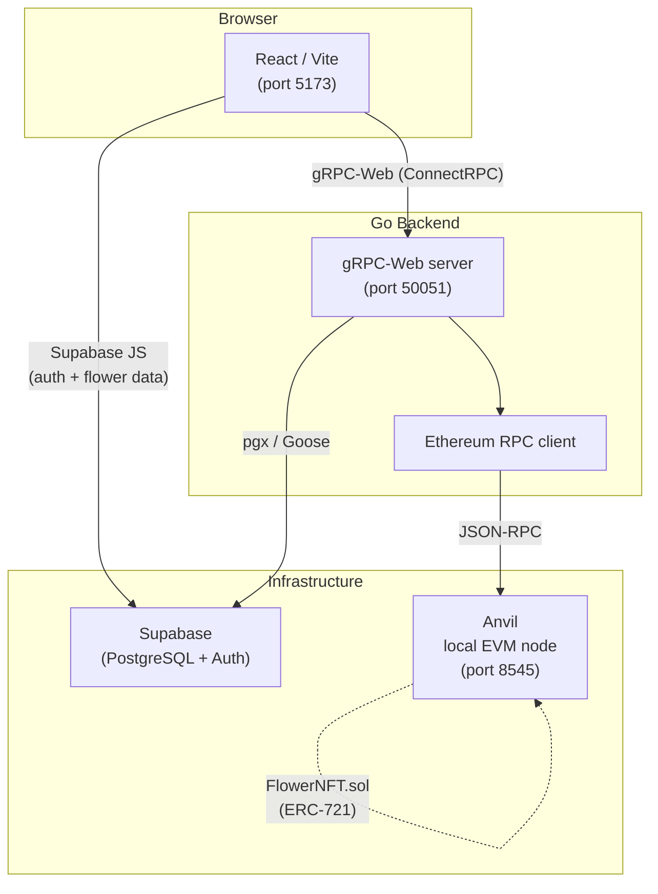

# Petal Pixel

> Generate algorithmically unique flower NFTs, save them to the cloud, and mint them on-chain — all from a single React app backed by a Go gRPC service.

## Live Demo

> Coming soon — link will be added here once deployed.

## Screenshots

> _Screenshots will be placed in `docs/assets/` once the deployment environment is set up._
>
> | Create & Customise | My Flowers Gallery | Mint on-chain |
> |---|---|---|
> | _(screenshot)_ | _(screenshot)_ | _(screenshot)_ |

---

## What is Petal Pixel?

Petal Pixel is a full-stack Web3 application where users:

1. **Generate** a unique procedural flower by entering a word (used as a seed) and tweaking visual parameters via real-time sliders.
2. **Save** the flower to their account; all data is persisted in Supabase so it appears on every device they log in from.
3. **Mint** it as an ERC-721 NFT on a local Ethereum network (Anvil), receiving a transaction hash and token URI.

The project was built to exercise the full integration path: browser UI ↔ gRPC service ↔ cloud database ↔ smart contract.

---

## Architecture



### Data flow: Save a flower
1. User adjusts sliders → React calls `CreateFlower` via gRPC-Web.
2. Go server generates deterministic params, writes a row to `flowers` (Supabase PostgreSQL).
3. Frontend also writes a `user_flowers` row directly via Supabase JS (includes full `params` JSON for cross-device sync).

### Data flow: Mint
1. Frontend calls `MintFlower` gRPC method with the flower's UUID.
2. Go server looks up the flower, builds NFT metadata, calls `mint()` on `FlowerNFT.sol` via JSON-RPC.
3. Transaction hash + token URI are returned to the frontend and persisted to `user_flowers`.

---

## Tech Stack

### Frontend — `petal-pixel-studio/`

| Area | Technology |
|---|---|
| Framework | React 18 + Vite 7 |
| Language | TypeScript 5 |
| Routing | React Router 6 (data router — required for `useBlocker`) |
| State | Zustand 5 with `persist` middleware (localStorage cache) |
| Server state | TanStack Query 5 |
| UI components | shadcn/ui (Radix UI primitives + Tailwind CSS 3) |
| 3D rendering | Three.js + React Three Fiber + Drei |
| Animations | Framer Motion |
| Theming | next-themes (dark / light) |
| Forms | react-hook-form + Zod |
| Backend transport | ConnectRPC (`@connectrpc/connect-web`) over gRPC-Web |
| Auth + DB | Supabase JS v2 |
| Testing | Vitest + Testing Library + Playwright |

### Backend — `flower-backend/`

| Area | Technology |
|---|---|
| Language | Go 1.25 |
| API protocol | gRPC (google.golang.org/grpc) + gRPC-Web (improbable-eng) |
| Schema | Protocol Buffers v3, generated via Buf CLI |
| Database driver | pgx v5 (simple protocol mode for PgBouncer / Supabase Pooler) |
| Migrations | Goose v3 (auto-runs on startup) |
| Asset storage | AWS S3 SDK v2 (optional, for NFT image upload) |
| Blockchain client | Custom Ethereum JSON-RPC over `golang.org/x/net` |
| Config | `godotenv` (`.env` file) |

### Web3 / Smart Contracts — `flower-backend/contracts/`

| Area | Technology |
|---|---|
| Contract language | Solidity ^0.8.20 |
| Standard | ERC-721 with URI storage (`OpenZeppelin v5.6.1`) |
| Dev environment | Foundry (Forge + Anvil) |
| Local chain | Anvil at `chain-id 1337` |
| Wallet | MetaMask (browser extension) |

### Dev Tooling — root

| Tool | Purpose |
|---|---|
| `go-task` / `Taskfile.yml` | One-command startup (`task dev`) and shutdown (`task stop`) |
| `tools/dev/deploy.ps1` | Forge script → broadcast → extract contract address → write `.task.env` |
| `tools/dev/run-backend.ps1` | Load `.task.env` + `.env`, set `CHAIN_ID`, run `go run` |
| `tools/dev/stop.ps1` | Kill processes on ports 8545 / 50051 / 8080 / 5173 |

---

## Repository Layout

```
petal-pixel/
├── Taskfile.yml                  # one-command dev runner
├── tools/dev/                    # PowerShell helper scripts
│   ├── deploy.ps1                # forge deploy + address extraction
│   ├── run-backend.ps1           # backend env loader + runner
│   └── stop.ps1                  # kill dev processes by port
│
├── flower-backend/               # Go gRPC server + Solidity contracts
│   ├── cmd/server/main.go        # entry point
│   ├── contracts/FlowerNFT.sol   # ERC-721 NFT contract
│   ├── script/Deploy.s.sol       # Foundry deployment script
│   ├── internal/
│   │   ├── api/grpc/             # gRPC service handlers + DB store
│   │   ├── flower/               # procedural flower generator
│   │   └── nft/                  # NFT metadata builder
│   ├── proto/flower/v1/          # Protobuf service definition
│   ├── gen/                      # Buf-generated Go code
│   ├── db/migrations/            # Goose SQL migrations
│   └── foundry.lock              # Foundry dependency lock (OZ v5.6.1)
│
└── petal-pixel-studio/           # React / Vite frontend
    ├── src/
    │   ├── pages/                # CreateFlower, MyFlowers, NftCollection …
    │   ├── stores/flowerStore.ts # Zustand store (Supabase as source of truth)
    │   ├── integrations/         # Supabase client + types; gRPC client
    │   ├── math/                 # Procedural flower geometry (pure TS)
    │   └── components/           # UI components (shadcn + custom)
    └── supabase/migrations/      # SQL applied to the Supabase project
```

---

## Quickstart (Windows)

### Prerequisites

| Tool | Install |
|---|---|
| Go ≥ 1.22 | https://go.dev/dl |
| Node.js ≥ 20 | https://nodejs.org |
| Foundry | `powershell -c "irm https://foundry.paradigm.xyz \| iex"` |
| go-task | `go install github.com/go-task/task/v3/cmd/task@latest` |
| MetaMask | Browser extension — import Anvil account 0 with the key printed on `anvil` startup |

Make sure `$(go env GOPATH)\bin` is in your `PATH` so that `task` is found.

### 1. Clone

```powershell
git clone https://github.com/VoixKz/petal-pixel.git
cd petal-pixel
```

### 2. Install Foundry dependencies (OpenZeppelin)

```powershell
cd flower-backend
forge install          # reads foundry.lock — installs OZ v5.6.1 into lib/
cd ..
```

### 3. Install frontend dependencies

```powershell
cd petal-pixel-studio
npm install
cd ..
```

### 4. Configure environment files

Copy the examples and fill in your values:

```powershell
# Backend
copy flower-backend\.env.example flower-backend\.env

# Frontend
copy petal-pixel-studio\.env.example petal-pixel-studio\.env
```

**`flower-backend/.env`** — key values:

| Variable | Description |
|---|---|
| `DB_DSN` | Supabase PostgreSQL connection string (from your Supabase project settings) |
| `S3_*` | Supabase Storage S3 endpoint, keys, bucket, and public base URL (see `flower-backend/.env.example`) |
| `CHAIN_ID` | `1337` (matches Anvil default in `Taskfile.yml`) |
| `NFT_CONTRACT_ADDRESS` | Auto-written by `task deploy` into `.task.env` — leave as `0x000…` initially |

**`petal-pixel-studio/.env`** — key values:

| Variable | Description |
|---|---|
| `VITE_SUPABASE_URL` | Your Supabase project URL |
| `VITE_SUPABASE_PUBLISHABLE_KEY` | Supabase anon / public key |
| `VITE_FLOWER_BACKEND_URL` | `http://localhost:50051` |
| `VITE_CHAIN_ID` | `1337` |
| `VITE_RPC_URL` | `http://127.0.0.1:8545` |

### 5. Apply Supabase migrations

In your Supabase dashboard → **SQL Editor**, run the files in order:

```
petal-pixel-studio/supabase/migrations/20260321201338_*.sql
petal-pixel-studio/supabase/migrations/20260405140000_user_flowers.sql
petal-pixel-studio/supabase/migrations/20260405150000_user_flowers_full_data.sql
petal-pixel-studio/supabase/migrations/20260408120000_profiles_rls_and_user_flowers_updated_at.sql
```

### 6. Run everything

```powershell
task dev
```

This single command:
1. Starts **Anvil** (local EVM node, `chain-id 1337`) in a new PowerShell window.
2. Deploys **FlowerNFT.sol** via `forge script --broadcast` and writes the contract address to `.task.env`.
3. Starts the **Go gRPC backend** (reads `.env` + `.task.env`) in a new window.
4. Starts the **Vite dev server** in a new window.

Open `http://localhost:5173`.

To stop all processes:

```powershell
task stop
```

---

## Key Engineering Decisions

### gRPC-Web over REST
The frontend communicates with the Go backend using the ConnectRPC protocol (gRPC-Web), providing typed, contract-first API calls with zero manual serialisation. The Protobuf schema lives in `flower-backend/proto/` and is compiled by the Buf CLI into TypeScript stubs in `petal-pixel-studio/src/gen/` and Go stubs in `flower-backend/gen/`.

### Supabase as single source of truth
All flower data (including the full `params` JSON) is written to `user_flowers` in Supabase on every save. `loadFromBackend` in `flowerStore.ts` queries Supabase directly on app mount, so the flower gallery is identical on every device and browser the user signs in from. `localStorage` is used only as a fallback cache.

### Hardened CRUD
- Duplicate-save prevention: `editingFlowerId` is set immediately after the first save, making all subsequent saves updates rather than inserts.
- Unsaved-changes guard: React Router's `useBlocker` (requires a data router) intercepts in-app navigation; a `beforeunload` listener covers browser refresh/close. A three-option dialog (Save & leave / Discard / Stay) is shown when there are pending changes.
- Parameter-level dirty tracking: a `useRef` snapshot of `params` is taken on edit mode entry and compared on every render to detect slider-only changes.
- `isSaving` flag: disables the Save button during an ongoing request, preventing double-submission.

### Foundry + Anvil for local Web3
The smart contract is compiled and deployed with Foundry. `deploy.ps1` broadcasts the deployment, parses the contract address from the `broadcast/run-latest.json` artifact, and writes it to `.task.env` so the backend picks it up without manual copy-paste.

---

## Security Notes

- **`.env` files are never committed.** Both `flower-backend/.env` and `petal-pixel-studio/.env` are in `.gitignore`. Only `.env.example` files are versioned.
- **`.task.env` is never committed.** It contains the ephemeral `NFT_CONTRACT_ADDRESS` generated at runtime and is also in `.gitignore`.
- **Anvil is a local-only testnet.** Private keys printed by Anvil are well-known test keys with no real value. Never use them on mainnet.
- **Supabase RLS** is enabled on the `user_flowers` table — users can only read and write their own flower records.

---

## License

MIT
