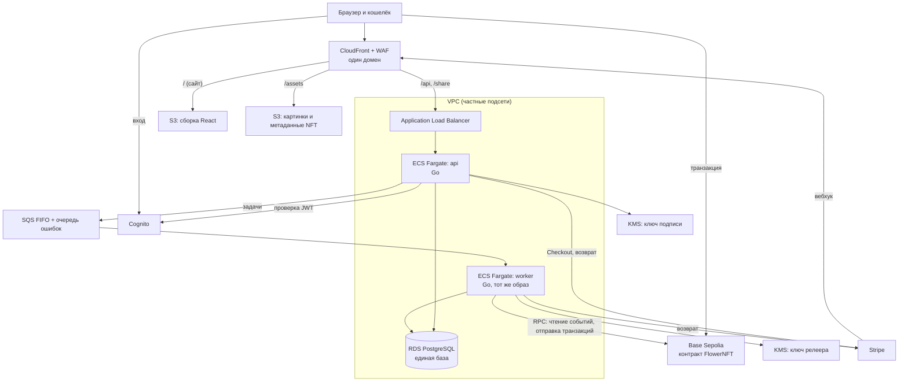
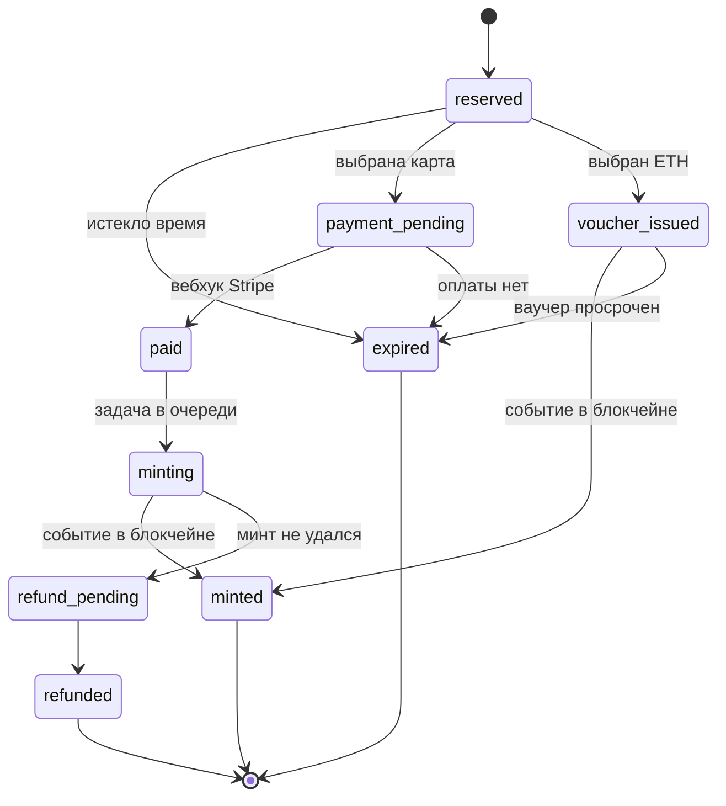
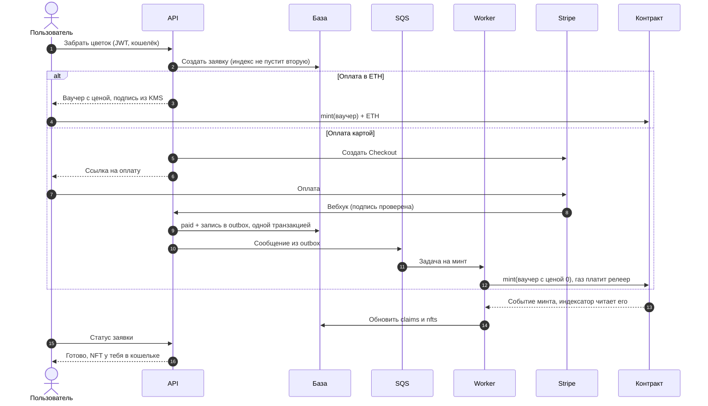

# Petal Pixel: план выхода в продакшен

Черновик от 2026-10-31. Основан на проверке кода ветки `feat/richer-flower-generation` (HEAD `b391117`).
Цены и ограничения сервисов проверены в тот же день, источники в конце.

## 1. Коротко

Твоё ощущение верное: система собрана некорректно. Генерация и интерфейс сильные, но вокруг них нет продукта: две несвязанные базы, бэкенд верит клиенту, блокчейн и хранилище работают только на ноутбуке.

План:

1. **Перепроектировать систему:** одна база, модульный бэкенд, очередь для долгих операций, блокчейн как источник правды о владении NFT.
2. **Развернуть на AWS** через Terraform и CI/CD.
3. **Закрыть безопасность:** вход через Cognito, проверка прав на сервере, подпись минта ключом из KMS.
4. **Подключить оплату:** ETH в тестовой сети и карты через Stripe в песочнице.
5. **Учиться по ходу:** код пишешь ты, Claude Code объясняет и проверяет.

Срок: примерно 16–20 недель при 10 часах в неделю. Это грубая оценка, она уточнится после первых этапов.

## 2. Что сейчас не так

| # | Проблема | Почему это плохо | Где | Этап |
|---|---|---|---|---|
| 1 | Две несвязанные базы: Supabase (`profiles`, `user_flowers`) и Postgres (`flowers`, `mints`) | Нельзя одним запросом узнать, чей цветок и кто его заминтил. Данные расходятся | `petal-pixel-studio/supabase/`, `flower-backend/db/` | 3 |
| 2 | У цветка нет владельца | Непонятно, кто имеет право на цветок | `db/migrations/00001_init.sql` | 3 |
| 3 | Каждая генерация перезаписывает глобальную запись цветка | Настройка генератора меняет страницу `/share` и данные уже существующих цветов | `store.go`, `UpsertFlower` | 3 |
| 4 | Подготовка минта затирает чужой подтверждённый минт | Второй человек с тем же именем стирает запись первого | `store.go`, `UpsertMintPrepared` | 6 |
| 5 | Контракт принимает любой `tokenURI` от любого адреса | Кто угодно может заливать мусор в твою коллекцию, минуя бэкенд | `contracts/FlowerNFT.sol` | 5 |
| 6 | Бэкенд никак не проверяет пользователя | Любой может вызвать любую операцию | `cmd/server/main.go` | 4 |
| 7 | Бэкенд не умеет читать блокчейн | `ConfirmMint` верит любому `tx_hash` от клиента | `flower_server.go` | 6 |
| 8 | `GET /api/flowers` отдаёт всем все имена, без лимита | Утечка личных данных: люди вводят имена близких | `cmd/server/main.go`, `ListFlowers` | 4 |
| 9 | Картинку NFT рисует и присылает клиент | Владелец может подменить изображение | `service.proto`, `image_png` | 6, 9 |
| 10 | Всё выполняется синхронно | Транзакция идёт дольше запроса. Если процесс упадёт, операция потеряется | вся архитектура | 7 |
| 11 | Адреса и инфраструктура только локальные | NFT не откроется в кошельке, превью не появится в Telegram | `docker-compose.yml` | 2 |
| 12 | Контейнеры запускаются от root, фронт работает через `vite dev`, миграции идут при старте сервера | Для продакшена это небезопасно и ненадёжно | `Dockerfile`, `main.go` | 2 |
| 13 | Два стиля API (grpc-web и обычный HTTP) и настройка CORS | Лишняя сложность, которую можно убрать | `main.go` | 3 |
| 14 | Генератор не заморожен: правки v3 шли под прежней меткой `v2` | Одно имя в разное время даёт разные цветы. После минта это недопустимо | `generator.go` | 3 |

## 3. Требования

**Что делает продукт**

1. Человек вводит имя и сразу видит цветок, без регистрации.
2. После входа сохраняет цветы в свой сад.
3. Делится ссылкой с красивым превью.
4. Забирает цветок как NFT, платит ETH или картой.
5. Видит NFT в кошельке.

**Масштаб и надёжность.** Это портфолио, а не высоконагруженный сервис, поэтому целимся скромно:

| Показатель | Цель |
|---|---|
| Пользователи | до 1 000 в месяц, до 50 одновременно |
| Ответ API (p95) | меньше 300 мс, без учёта блокчейна |
| Доступность | около 99%, одна зона для базы |
| Потеря данных при аварии | не больше 24 часов (автобэкапы RDS) |
| Восстановление | около часа |

**Ограничения:** один разработчик, который учится; бюджет близок к нулю; всё только в тестовой сети и песочнице платежей.

## 4. Целевая архитектура

### 4.1 Схема

### 4.2 Принципы

- **Модульный монолит, а не микросервисы.** Один Go-образ, два процесса: `api` отвечает на запросы, `worker` выполняет долгие задачи. Для одного разработчика микросервисы дают только лишнюю сложность. Границы проходят по пакетам: `flower`, `garden`, `claims`, `payments`, `chain`, `auth`.
- **Два источника правды, у каждого своя зона.** Postgres отвечает за пользователей, сохранённые цветы и заказы. Блокчейн отвечает за то, кому принадлежит NFT. Бэкенд читает события контракта и обновляет базу, а не верит клиенту.
- **Клиенту не доверяем.** Всё, что влияет на деньги и права, проверяет сервер или контракт.
- **Медленное и ненадёжное выполняется асинхронно.** Обработка оплаты, отправка транзакций и возвраты идут через очередь и переживают падение процесса.
- **Один домен.** Сайт, API и картинки живут под одним адресом, поэтому CORS становится не нужен.
- **Инфраструктура только в коде.** Ничего не настраиваем руками в консоли AWS.

### 4.3 Что именно является NFT

Предполагаемая модель: **одно имя — один NFT, кто первый, тот и забрал** (решение 2 в разделе 11).

- `flower_id` считается из нормализованного имени и версии генератора.
- NFT соответствует каноническому цветку этого имени. Правки ползунками остаются личным оформлением и в NFT не попадают.
- После первого минта версия генератора замораживается навсегда. Изменения идут только под новой версией, а «золотые» тесты фиксируют результат для набора имён.

Нерешённые риски этой модели: скупка популярных имён, похожие символы (кириллическая и латинская «А») и оскорбительные имена на публичных страницах. Цена минта частично защищает от скупки, остальное решаем на этапе 8.

### 4.4 Модель данных

Одна база PostgreSQL. Зачем нужна каждая таблица:

| Таблица | Назначение | Важная деталь |
|---|---|---|
| `users` | Пользователь | Связан с Cognito через уникальный `cognito_sub` |
| `flowers` | Только сохранённые и заминченные цветы | Запись неизменяема. Обычная генерация в базу не пишет |
| `saved_flowers` | Сад пользователя | Ключ `(user_id, flower_id)`, личные настройки, избранное |
| `claims` | Заявка на цветок и её статус | Частичный уникальный индекс: одна активная заявка на цветок |
| `payments` | Платежи | Уникальный идентификатор платежа у провайдера |
| `webhook_events` | Обработанные вебхуки | Уникальный `event_id` защищает от повторов |
| `outbox` | Сообщения для очереди | Пишутся в одной транзакции с изменением данных |
| `nfts` | Отражение состояния блокчейна | Заполняет только индексатор |
| `chain_cursor` | Последний прочитанный блок | Индексатор продолжает с него после перезапуска |

Где что хранится:

| Данные | Где | Почему там |
|---|---|---|
| Вход: email, пароль, Google, токены | Cognito | Пароли не проходят через наш код |
| Профиль: имя, аватар | `users` в PostgreSQL | Связан с Cognito через `cognito_sub` |
| Сад, заявки, платежи | PostgreSQL | Можно менять вместе в одной транзакции |
| Картинки и метаданные NFT | S3 | Большие файлы, раздаются через CloudFront |
| Данные карт | Stripe | Мы их никогда не получаем и не храним |
| Владелец NFT | Блокчейн, копия в `nfts` | Блокчейн решает, база только отражает |
| Ключи подписи | KMS | Ключ нельзя извлечь |
| Секреты сервисов | Secrets Manager | Доступ только у нужной роли |

Полный список компонентов, кроме показанных на схеме 4.1: Route 53 и ACM (домен и TLS), NAT Gateway (исходящий трафик из частной сети), очередь ошибок DLQ, Secrets Manager, Alchemy (доступ к блокчейну), ECR (образы), CloudTrail (журнал действий в AWS), GitHub Actions и Terraform.

Статусы заявки:

### 4.5 Минт

Контракт v2 принимает минт только с **ваучером**. Это разрешение, которое бэкенд подписал ключом из KMS (стандарт EIP-712). В ваучере указаны цветок, получатель, адрес метаданных, цена и срок действия. Контракт проверяет подпись и отклоняет второй минт того же цветка, поэтому обойти бэкенд нельзя.

Оба способа оплаты используют одну функцию `mint`. Отличаются только ценой в ваучере и тем, кто отправляет транзакцию.

Метаданные и картинки лежат в S3 под ключом с хэшем содержимого и не перезаписываются: загрузка идёт с условием «только если объекта ещё нет». Постоянные файлы хранятся в той части инфраструктуры, которая не выключается, иначе NFT потеряют картинки.

### 4.6 API

| Операция | Доступ | Что делает |
|---|---|---|
| `PreviewFlower(name)` | Открыта, с лимитом | Считает цветок, в базу не пишет |
| `GetFlower(id)` | Открыта | Только сохранённые цветы, которыми поделились |
| `SaveFlower`, `ListGarden`, `DeleteFlower` | Вход | Только свои цветы |
| `CreateClaim`, `GetClaim` | Вход | Заявка на NFT и её статус |
| `POST /api/webhooks/stripe` | Подпись Stripe | Единственный вход, где проверяется подпись вместо JWT |
| `GET /share/{id}` | Открыта | HTML с OG-тегами для Telegram |
| `/healthz`, `/readyz` | Только ALB | Проверки живости и готовности |

Весь API переходит на ConnectRPC (`connect-go`). Сервер станет обычным HTTP-обработчиком, обёртка grpc-web уйдёт, а `.proto` и фронтовый клиент останутся почти без изменений.

## 5. Стек

| Слой | Сейчас | Цель | Почему |
|---|---|---|---|
| Фронт | React, Vite, Three.js | То же, статика в S3 + CloudFront | Менять незачем |
| Вход | Supabase Auth | Cognito + `oidc-client-ts` (PKCE) | Бесплатно до 10 000 активных пользователей, сервис AWS. Освоишь OIDC |
| Бэкенд | Go, grpc-go + grpc-web | Go, `connect-go` | Один HTTP-обработчик |
| База | Supabase + Postgres | RDS PostgreSQL | Одна база |
| Миграции | goose при старте | goose, отдельная задача при деплое | Нет гонок при запуске нескольких копий |
| Вычисления | Docker Compose | ECS Fargate (ARM) | Тот же Docker, но управляемый |
| Очередь | нет | SQS FIFO + DLQ | Порядок нужен для nonce релеера |
| Хранилище | MinIO | S3 | API совместимо, код почти не меняется |
| CDN и защита | нет | CloudFront, бесплатный тариф | CDN, WAF, DNS за $0 |
| Ключи | публичный тестовый ключ anvil в `tools/docker/deploy.sh` | AWS KMS (secp256k1) | Ключ нельзя извлечь, каждая подпись видна в журнале |
| Секреты | `.env` | Secrets Manager | Ротация и доступ по ролям |
| Сеть блокчейна | anvil | Base Sepolia, RPC от Alchemy | Дешёвая и быстрая тестовая сеть |
| Контракт | ERC-721 без ограничений | Foundry, OpenZeppelin, EIP-712, Slither | Тесты и статический анализ |
| Клиент блокчейна в Go | нет | `go-ethereum` | События, транзакции, EIP-712 |
| Инфраструктура | нет | Terraform, S3 backend с `use_lockfile` | Самый востребованный инструмент, работает с любым облаком |
| CI/CD | нет | GitHub Actions + OIDC в AWS | Без постоянных ключей в GitHub |
| Логи и метрики | stdout | CloudWatch, алерты через SNS | Встроено в AWS |
| e2e-тесты | нет | Playwright (уже установлен) | Проверяет главный сценарий |

### Почему AWS, а не Azure

Рекомендую AWS. В США у него больше вакансий: 168 тыс. против 142 тыс. у Azure на май 2026 (данные LinkedIn в пересказе вторичного источника, поэтому это лишь ориентир). При этом доля Azure растёт. Бэкенд уже использует AWS SDK для S3. Есть официальный AWS MCP Server для работы из Claude Code. Концепции переносятся, поэтому после AWS освоить Azure намного проще:

| AWS | Azure |
|---|---|
| CloudFront + WAF | Front Door + WAF |
| S3 | Blob Storage |
| ECS Fargate + ALB | Container Apps |
| RDS PostgreSQL | Database for PostgreSQL Flexible Server |
| SQS | Service Bus |
| Cognito | Entra External ID |
| KMS, Secrets Manager | Key Vault (поддерживает P-256K, это secp256k1) |
| CloudWatch | Azure Monitor |
| IAM-роли | Managed Identities |

### От чего отказываемся

| Вариант | Почему нет |
|---|---|
| Микросервисы, EKS | Сложность и цена без пользы при одном разработчике |
| App Runner | Закрыт для новых клиентов с 30 апреля 2026 |
| ECS Express Mode | Удобен в работе, но скрывает сеть и балансировщик, а здесь важно понять их |
| Lambda + API Gateway | Дешевле в простое, но требует переделки бэкенда. Хорошая альтернатива для будущего проекта |
| Aurora Serverless | Для такого объёма обычная RDS проще и понятнее |
| Прямая работа фронта с базой | Именно от этого уходим: проверка прав должна быть в одном месте |

## 6. Безопасность

| Угроза | Защита | Этап |
|---|---|---|
| Подделка токена | Проверка JWT по JWKS: подпись, `iss`, `client_id`, `token_use`, срок | 4 |
| Доступ к чужим данным | Проверка владельца на сервере, тесты на чужой доступ | 4 |
| Перебор и спам | WAF ограничивает по IP, приложение по пользователю | 4, 8 |
| Обход бэкенда при минте | Ваучер EIP-712 в контракте | 5 |
| Повтор ваучера | Домен EIP-712 (сеть и контракт), один минт на цветок, срок действия | 5 |
| Кража ключа подписи | KMS: ключ не извлекается, право `kms:Sign` только у нужной роли, журнал CloudTrail | 5 |
| Ошибка в контракте | Тесты, включая fuzz, Slither, `Ownable2Step`, `Pausable` | 5 |
| Два покупателя на один цветок | Частичный уникальный индекс в базе, резерв с таймером | 6 |
| Поддельный вебхук | Проверка подписи Stripe по исходному телу запроса | 7 |
| Повторный вебхук | Уникальный `event_id`, идемпотентная обработка | 7 |
| Списали деньги, минт не прошёл | Очередь ошибок, автоматический возврат | 7 |
| Доступ к базе из интернета | Частные подсети, Security Groups, шифрование | 2 |
| Обход CloudFront | ALB принимает только сети CloudFront и секретный заголовок | 2 |
| Открытые бакеты | Block Public Access, доступ только через CloudFront (OAC) | 2 |
| Утечка секретов | Secrets Manager, gitleaks в CI, пароль RDS управляется AWS | 2 |
| Ключи в CI | OIDC вместо постоянных ключей, защита ветки `main` | 2 |
| Уязвимые зависимости | Dependabot, `govulncheck`, `npm audit`, сканирование образов | 2, 8 |
| Взлом контейнера | Запуск не от root, минимальный образ, роль только с нужными правами | 2 |
| Вредная загрузка | Presigned URL с лимитом размера и типа, проверка, что файл действительно PNG | 6 |
| Утечка личных данных | Нет публичных списков, делиться можно только явно, имена не пишем в логи, удаление аккаунта | 4, 8 |
| Подмена картинки NFT | Сначала проверка владельца, позже рендер на сервере | 6, 9 |
| Обход авторизации «для теста» | В коде нет режима обхода. В разработке используем настоящий пул Cognito | 4 |
| Инъекция промпта в Claude Code | У Claude только роль AWS на чтение, деплой идёт через CI, `.env` закрыт правилом `deny` и хуком | 0 |

Две последние строки не теоретические. Один из агентов уже оставлял в `ProtectedRoute` отладочный обход авторизации, который пришлось откатывать. А при прошлом ревью другой агент встретил текст, пытавшийся склонить его отклонять находки.

## 7. Оплата

**Факты, которые определяют дизайн:**

- Stripe запрещает вторичную торговлю NFT.
- Первичный минт и продажа NFT у Stripe в категории ограниченных: нужна дополнительная проверка и одобрение.
- Казахстана нет в списке стран Stripe, Сингапур есть.
- Песочница Stripe доступна сразу после создания аккаунта. Можно ли создать аккаунт из неподдерживаемой страны, документация не подтверждает: это проверяем на этапе 0.

**Предлагаемое решение:**

| Способ | Как работает | Что показывает |
|---|---|---|
| ETH | Пользователь платит прямо в контракт в Base Sepolia | Web3-оплату, работает без договоров |
| Карта | Stripe Checkout в песочнице, дальше вебхук, очередь и минт за счёт релеера | Вебхуки, идемпотентность, надёжную обработку |

Реальные деньги в этот план не входят. Для них нужны юрлицо, налоги, аудит контракта, основная сеть и одобрение Stripe. В README честно указываем: «testnet, Stripe sandbox».

**Если Stripe недоступен:** запасной вариант для карт — Crossmint Staging, там есть тестовая оплата картой. Подтверждённого примера минта NFT картой на Base Sepolia я не нашёл, поэтому это тоже проверяем на этапе 0. Логика заявок и статусов при такой замене почти не меняется.

**Для реального запуска** можно рассмотреть Crossmint или продавать через Stripe обычные цифровые товары, например постер в высоком разрешении: это не NFT.

## 8. Стоимость

Цены для `us-east-1`, оценка ориентировочная. Перед запуском проверь в AWS Pricing Calculator.

**Постоянная часть, не выключается: около $5 в месяц**

| Сервис | В месяц |
|---|---|
| CloudFront Free: CDN, WAF (5 правил), DNS, защита от DDoS | $0 |
| S3 до 5 ГБ, покрывается кредитом этого тарифа | $0 |
| Cognito до 10 000 активных пользователей | $0 |
| KMS, 2 ключа | $2 + подписи |
| Secrets Manager, ECR, SQS, логи | ≈ $2 |
| Домен | ≈ $1 |

**Рабочая часть, включаешь на время работы: ≈ $0.13 в час**

| Сервис | В месяц, если работает постоянно |
|---|---|
| ALB + 2 публичных IPv4 | ≈ $25 |
| Fargate ARM, 2 задачи по 0.25 vCPU / 0.5 ГБ | ≈ $15 |
| RDS `db.t4g.micro` + 20 ГБ gp3 | ≈ $14 |
| NAT Gateway + IPv4 | ≈ $37 |
| Логи и прочее | ≈ $2 |
| **Итого** | **≈ $93** |

Как держать расходы низкими:

- Terraform разделён на две части: `foundation` работает всегда, `runtime` поднимается и удаляется командой. 10 часов в неделю стоят примерно $6 в месяц.
- База сохраняется снимком перед удалением и восстанавливается при подъёме.
- Самая дорогая строка, NAT Gateway, необязательна: задачи можно запускать в публичных подсетях с закрытым входящим трафиком. Выйдет около $63 при постоянной работе. Это рабочий компромисс, но частные подсети лучше смотрятся в портфолио, поэтому начинаем с них.
- Сразу настраиваем AWS Budgets с письмами на $10, $25 и $50.
- При регистрации выбирай **Paid plan**. Free plan ограничен отдельными сервисами и через 6 месяцев автоматически закрывает аккаунт вместе с данными. Новому аккаунту полагаются кредиты до $200.

## 9. План по этапам

Правило порядка: **деплой появляется рано**. Сначала пустое приложение проходит весь путь до AWS, потом каждая функция сразу попадает в настоящую среду.

### Этап 0. Подготовка (≈ 1 неделя)

- **Цель:** безопасно начать работу.
- **Ты делаешь:** объединяешь ветку с `main` через PR, защищаешь `main`, пишешь `CLAUDE.md`, настраиваешь `.claude/settings.json`, проверяешь создание аккаунта Stripe и запасной вариант Crossmint, принимаешь решения из раздела 11.
- **Учишься:** git flow, PR, защита веток, настройка рабочего окружения.
- **Claude Code:** стиль Learning, `/init`, правила доступа. Отдельно проверяем, что `.env` нельзя прочитать и через Bash: документация подтверждает запрет только для файловых инструментов.
- **Готово, когда:** `main` содержит актуальный код, а CI запускает тесты на каждый PR.

### Этап 1. Система на бумаге (≈ 1 неделя)

- **Цель:** принять архитектурные решения до написания кода.
- **Ты делаешь:** пишешь ADR (короткие записи решений) в `docs/adr/`: монолит, AWS, Cognito, модель NFT. Составляешь SQL-схему и разбираешь сценарии сбоев: что будет, если процесс упадёт на каждом шаге минта.
- **Учишься:** системному дизайну и формулировке компромиссов.
- **Claude Code:** plan mode, режим «найди дыры в моём дизайне».
- **Готово, когда:** ты можешь объяснить схему из раздела 4 вслух, без подсказок.

### Этап 2. Ходячий скелет на AWS (≈ 2–3 недели)

- **Цель:** сайт и пустой API работают на AWS, деплой идёт автоматически.
- **Ты делаешь:** защищаешь аккаунт (MFA, IAM Identity Center, бюджеты, CloudTrail), пишешь Terraform для `foundation` и `runtime`, собираешь безопасные образы, настраиваешь GitHub Actions с OIDC.
- **Учишься:** VPC, подсети, Security Groups, IAM, ECS, ALB, RDS, CloudFront, Terraform.
- **Claude Code:** AWS MCP Server с ролью только на чтение, разбор ошибок `terraform plan`, хук с `terraform fmt`.
- **Готово, когда:** push в `main` обновляет `/healthz` на твоём домене, а `runtime` поднимается и удаляется одной командой.

### Этап 3. Единая модель данных и бэкенд (≈ 2–3 недели)

- **Цель:** новая схема и понятная структура кода.
- **Ты делаешь:** пишешь миграции, делишь код на модули, переводишь API на `connect-go`, замораживаешь генератор, добавляешь «золотые» тесты и интеграционные тесты на настоящем Postgres.
- **Учишься:** моделированию данных, индексам, транзакциям, границам модулей.
- **Claude Code:** TDD, git worktrees, ревью твоего diff.
- **Готово, когда:** перезапись цветов и минтов невозможна, и это подтверждают тесты.

### Этап 4. Вход и права (≈ 2 недели)

- **Цель:** приложение знает пользователя, Supabase удалён.
- **Ты делаешь:** настраиваешь Cognito в Terraform, вход через OIDC с PKCE, пишешь проверку JWT в Go, проверки владельца, лимиты запросов, закрываешь `/api/flowers`.
- **Учишься:** OAuth2/OIDC, разнице аутентификации и авторизации, IDOR.
- **Claude Code:** `/security-review`, собственный skill с чек-листом проверки прав.
- **Готово, когда:** тесты подтверждают, что чужие данные недоступны.

### Этап 5. Контракт и ключи (≈ 2 недели)

- **Цель:** контракт v2 в Base Sepolia, обойти бэкенд нельзя.
- **Ты делаешь:** пишешь контракт и тесты Foundry, включая fuzz, проверяешь Slither, деплоишь и верифицируешь контракт. В Go пишешь подпись через KMS: разбор DER, нормализация `s`, вычисление `v`.
- **Учишься:** Solidity, EIP-712, ECDSA, газ, управлению ключами.
- **Claude Code:** отдельный субагент-ревьюер контракта, который ищет атаки, а ты их закрываешь.
- **Готово, когда:** подпись из Go принимается контрактом, а подделанная отклоняется. Это проверяет автоматический тест.

### Этап 6. Минт за ETH от начала до конца (≈ 2 недели)

- **Цель:** настоящий минт, видимый в кошельке.
- **Ты делаешь:** пишешь заявки с резервом, выдачу ваучера, индексатор событий с учётом подтверждений блоков, неизменяемые метаданные.
- **Учишься:** гонкам данных, идемпотентности, eventual consistency.
- **Claude Code:** отладка с гипотезами, написание сценариев гонок вместе с Claude.
- **Готово, когда:** из двух одновременных заявок побеждает одна, а NFT с картинкой виден в MetaMask.

### Этап 7. Оплата картой (≈ 2 недели)

- **Цель:** платёж в песочнице приводит к минту, сбой приводит к возврату.
- **Ты делаешь:** подключаешь Stripe Checkout, вебхук, outbox, SQS, worker с релеером и управлением nonce, автоматический возврат.
- **Учишься:** вебхукам, transactional outbox, очередям, повторам, DLQ.
- **Claude Code:** Stripe CLI через bash, фоновые задачи, проверка сценариев сбоя.
- **Готово, когда:** при остановке worker посреди минта заказ всё равно завершается или деньги возвращаются.

### Этап 8. Защита и наблюдаемость (≈ 1–2 недели)

- **Цель:** ты знаешь, что происходит в системе, и она устойчива к атакам.
- **Ты делаешь:** проходишь таблицу угроз, настраиваешь заголовки безопасности, дашборды, алерты (ошибки 5xx, DLQ, баланс релеера), учебное восстановление из бэкапа, нагрузочный тест k6, удаление аккаунта.
- **Учишься:** эксплуатации, SLO, реагированию на инциденты.
- **Claude Code:** headless `claude -p` в CI, анализ логов через MCP.
- **Готово, когда:** алерты реально срабатывают, а база восстанавливается из снимка.

### Этап 9. Подготовка к показу (≈ 1–2 недели)

- **Цель:** проект готов для портфолио.
- **Ты делаешь:** e2e на Playwright, визуальная проверка 100 имён, тест на телефонах, README на английском со схемой, ADR, отчётом о затратах и видео.
- **Учишься:** тестированию продукта и рассказу о своей работе.
- **Claude Code:** Claude в браузере для проверки интерфейса, code review всей системы.
- **Готово, когда:** посторонний человек проходит сценарий без подсказок.

**По желанию после этого:** рендер NFT на сервере, IPFS, встроенные кошельки, перенос части системы на Azure.

## 10. Как работаем

1. **Код пишешь ты.** Claude объясняет, задаёт вопросы и проверяет. Код от Claude только по явной просьбе, например: «напиши сам».
2. **Перед кодом ты объясняешь подход.** Если объяснить не получается, сначала разбираемся.
3. **Подсказки идут по возрастанию:** вопрос, направление, пример, готовый код.
4. **Проверяет Claude, принимаешь решение ты.** Любое изменение ты можешь объяснить.
5. **Рутину можно отдавать.** Шаблонный код, который ты уже умеешь писать, Claude делает по просьбе. Новые концепции пишешь сам.
6. **Каждый этап заканчивается разбором:** что понял, где ошибся, что записать в `CLAUDE.md`.

Навыки Claude Code осваиваем постепенно, по таблице:

| Этап | Навык | Как это делается |
|---|---|---|
| 0 | Режим обучения | Стиль Learning в меню Output style: Claude оставляет `TODO(human)` и ждёт твой код |
| 0 | Память проекта | `/init`, `CLAUDE.md`, правила в `.claude/rules/` |
| 0 | Права доступа | `permissions.deny` в `.claude/settings.json`, хук `PreToolUse` для защиты `.env` |
| 0 | Управление контекстом | `/context`, `/compact`, `/clear` |
| 1 | Планирование | Режим Plan или `/plan`: правки запрещены, пока ты не утвердишь план |
| 2 | Подключение сервисов | `claude mcp add`, общий конфиг `.mcp.json`, AWS MCP Server с ролью на чтение |
| 2 | Автоматизация | Хук `PostToolUse` запускает `terraform fmt` после правок |
| 3 | Параллельная работа и откат | `claude --worktree <имя>`, `/rewind` |
| 3 | Проверка кода | `/code-review` на твоём diff |
| 4 | Свои инструменты | `.claude/skills/<имя>/SKILL.md`, `/security-review` |
| 5 | Субагенты | `.claude/agents/<имя>.md`, например ревьюер контрактов |
| 6 | Отладка | Гипотеза, проверка, вывод: Claude ведёт, диагноз ставишь ты |
| 7 | Фоновые задачи | Долгие процессы и несколько сессий через worktrees |
| 8 | Claude в CI | `claude -p`, `--output-format json`, `anthropics/claude-code-action@v1` |
| 9 | Полное ревью | `/code-review` по всей ветке, проверка интерфейса в браузере |

## 11. Решения, которые нужны от тебя

| # | Вопрос | Рекомендация | Что изменится при другом ответе |
|---|---|---|---|
| 1 | AWS или Azure | AWS | Заменяем сервисы по таблице из раздела 5, этапы те же |
| 2 | Модель NFT | Одно имя — один NFT | Если у каждого своя копия: `flower_id` зависит от пользователя, контракт разрешает повторы, ценность коллекции ниже |
| 3 | Страна аккаунта Stripe | Проверить, откроется ли аккаунт | Если нет: карта через Crossmint Staging |
| 4 | Часов в неделю и бюджет | 10 часов, до $20 в месяц | Меняются сроки и решение по NAT Gateway |

## 12. Что пересмотреть при росте

| Когда | Что менять |
|---|---|
| Важна доступность | RDS Multi-AZ, две копии каждого сервиса |
| Больше 1 минта в минуту | Несколько релеров, управление nonce в базе |
| Много чтения | Кэш на CloudFront, реплика для чтения |
| Реальные деньги | Аудит контракта, основная сеть, юрлицо, юрист |
| Ценность NFT | IPFS или Arweave, рендер на сервере |
| Команда растёт | Отдельные аккаунты AWS для окружений |

## Источники

- Stripe: [ограниченные виды бизнеса](https://stripe.com/legal/restricted-businesses), [страны](https://stripe.com/global), [активация аккаунта и песочница](https://stripe.com/docs/account/activate)
- Crossmint: [тестовая и основная среды](https://docs.crossmint.com/introduction/platform/staging-vs-production)
- AWS: [бесплатный уровень](https://aws.amazon.com/free/), [закрытие App Runner](https://docs.aws.amazon.com/ja_jp/apprunner/latest/dg/apprunner-availability-change.html), [AWS MCP Server](https://aws.amazon.com/about-aws/whats-new/2026/05/aws-mcp-server/)
- Цены AWS: [CloudFront](https://aws.amazon.com/cloudfront/pricing/), [тарифы CloudFront](https://docs.aws.amazon.com/AmazonCloudFront/latest/DeveloperGuide/flat-rate-pricing-plan.html), [Fargate](https://aws.amazon.com/fargate/pricing/), [VPC](https://aws.amazon.com/vpc/pricing/), [ALB](https://aws.amazon.com/elasticloadbalancing/pricing/), [KMS](https://aws.amazon.com/kms/pricing/), [Cognito](https://aws.amazon.com/cognito/pricing/), [RDS, сторонний расчёт](https://www.bytebase.com/dbcost/rds/instance/db.t4g.micro/)
- Подпись через KMS: [пример Chainlink на Go](https://docs.chain.link/crec/guides/signers/aws-kms)
- Terraform: [S3 backend и `use_lockfile`](https://developer.hashicorp.com/terraform/language/backend/s3)
- Azure: [типы ключей Key Vault](https://learn.microsoft.com/en-us/azure/key-vault/keys/about-keys-details), [Azure AD B2C и Entra External ID](https://skycloak.io/blog/azure-ad-b2c-end-of-sale-support-timeline/)
- Base: [деплой через Foundry](https://docs.base.org/tutorials/deploy-with-foundry)
- Рынок труда: [Citadel Cloud Management](https://www.citadelcloudmanagement.com/blog/aws-vs-azure-vs-gcp-which-cloud-platform-should-you-learn-first-in-2027), [Revelio Labs](https://www.reveliolabs.com/news/business/cloudy-forecast-for-aws)
